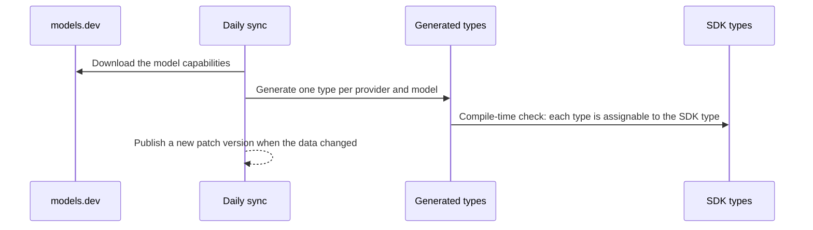

<div align="center">

<picture>
  <source media="(prefers-color-scheme: dark)" srcset="assets/logo-dark.png" />
  <source media="(prefers-color-scheme: light)" srcset="assets/logo-light.png" />
  
</picture>

<p align="center">Types for AI model options</p>
<p align="center">
  <a href="https://www.npmjs.com/package/types.ai" alt="types.ai"></a> <a href="https://github.com/zirkelc/types.ai/actions/workflows/ci.yml" alt="CI"></a>
</p>

</div>

This library provides TypeScript types that narrow the [`providerOptions`](https://ai-sdk.dev/docs/foundations/provider-options) of the [AI SDK](https://ai-sdk.dev) and the `modelOptions` of [TanStack AI](https://tanstack.com/ai) to one provider and model. The types are generated every day from the [models.dev](https://models.dev) database of model capabilities.

## Why?

AI SDKs type their model options per provider, not per model. However, the valid values change from model to model:

- **Reasoning effort**: the OpenAI options accept any reasoning effort, but `gpt-5` accepts only `minimal` to `high`, and `gpt-6-luna` accepts `none` to `max`
- **Model-only options**: effort updates, explicit cache TTLs and some service tiers exist only on some models
- **Sampling**: many reasoning models do not accept `temperature` or `top_p`, but the option types accept them for every model

A wrong value compiles, and then fails at run time with an API error. This library turns these errors into type errors.

## Installation

```bash
npm install -D types.ai
```

There is nothing else to install. The types build on the types of the SDK packages that your project already uses (for example `@ai-sdk/openai` or `@tanstack/ai-openai`), so these are optional peer dependencies.

## How It Works

A daily GitHub workflow downloads the [models.dev v2 API](https://models.dev/experimental/v2.0/api.json), and generates the types from it with one mapping per SDK package. The mapping connects the models.dev capabilities to the SDK option fields, for example `reasoning.effort` to `reasoningEffort`.



A generated check compiles each type against the SDK type. Thus an object that satisfies a type of this library is also accepted by the SDK.

models.dev is a community database, and a wrong value there gives a wrong type here. New and changed data is published automatically. Removed data (a model, an effort value) is reviewed by hand first, because it makes types narrower. It then also goes out as a patch release, so a patch update can remove a value that your code uses. Pin the version if you need stable types. A daily cross-check compares models.dev with the model catalogs of the AI SDK. Report wrong model data to [models.dev](https://github.com/anomalyco/models.dev). See [MAINTAINING.md](MAINTAINING.md) for the details of the pipeline.

## Usage

Pick the import path for your SDK:

| Import path | Use it for |
| --- | --- |
| `types.ai/ai-sdk/<provider>` | The types of `@ai-sdk/<provider>`, with a model parameter on the option types. The normal choice. |
| `types.ai/ai-sdk` | `ModelOptions` and `ProviderOptions` with the provider ID as a parameter, for code with more than one provider. |
| `types.ai/tanstack/<provider>` | The types of `@tanstack/ai-<provider>`, with a model parameter on the option types. |
| `types.ai/tanstack` | `ModelOptions` with the provider ID as a parameter. |
| `types.ai/models` | SDK-agnostic types of the model data, for example `ReasoningEffort`. |
| `types.ai/models/<provider>` | The model data of the provider at run time. |

> [!NOTE]
> `types.ai/ai-sdk` and `types.ai/tanstack` refer to the types of all provider packages of the SDK, and a project usually has only some of them. With `skipLibCheck: true` (the value that `tsc --init` sets), the providers that are not installed are simply not available. With `skipLibCheck: false`, TypeScript reports `Cannot find module` for them. Then use the provider entries.

All types follow the same rules:

1. **Unknown models**: a model ID that models.dev does not know gives the original SDK type.
2. **Missing data**: when models.dev does not state a capability, the field keeps the original SDK type. The types narrow only on data that exists.
3. **Not supported**: a field that a model does not support becomes `never`, for example `reasoningEffortUpdate` for `gpt-5`.
4. **Compatibility**: each type is assignable to the original SDK type.
5. **Fields that are not mapped** keep the original SDK type, for example `textVerbosity`.
6. **Other model types**: a model ID that the SDK knows only for another model type, for example the image model `gpt-image-2`, gives an error type, so `satisfies` fails. A model that the SDK also accepts as a language model (for example `gemini-2.5-flash-image`) keeps the options.

### AI SDK

`types.ai/ai-sdk/<provider>` exports all types of the AI SDK provider package. The option types get an optional model parameter. Use them with [`satisfies`](https://www.typescriptlang.org/docs/handbook/release-notes/typescript-4-9.html#the-satisfies-operator), as the AI SDK docs do, and add the model:

```typescript
import { openai } from '@ai-sdk/openai';
import { generateText } from 'ai';
import type { OpenAILanguageModelResponsesOptions } from 'types.ai/ai-sdk/openai';

await generateText({
  model: openai('gpt-6-luna'),
  prompt: 'Plan a three-day trip to Lisbon.',
  providerOptions: {
    openai: { reasoningEffort: 'minimal' } satisfies OpenAILanguageModelResponsesOptions<'gpt-6-luna'>,
    //        ~~~~~~~~~~~~~~~
    // Error: Type '"minimal"' is not assignable to type '"high" | "low" | "max" | "medium" | "none" | "xhigh" | null | undefined'.
  },
});
```

> [!IMPORTANT]
> The types do not change what `generateText()` infers by itself. The AI SDK uses its own option types internally, so the narrowing applies only where you write `satisfies` (or a type annotation).

#### Replace the Import

Without a model, the types are equal to the original types. Thus you can replace the type import, and then add the model where you want the narrowing.

```diff
- import type { OpenAILanguageModelResponsesOptions } from '@ai-sdk/openai';
+ import type { OpenAILanguageModelResponsesOptions } from 'types.ai/ai-sdk/openai';
```

```typescript
import type { OpenAILanguageModelResponsesOptions } from 'types.ai/ai-sdk/openai';

// With a model: narrowed to gpt-5
const options = { reasoningEffort: 'xhigh' } satisfies OpenAILanguageModelResponsesOptions<'gpt-5'>;
//                ~~~~~~~~~~~~~~~
// Error: Type '"xhigh"' is not assignable to type '"high" | "low" | "medium" | "minimal" | null | undefined'. Did you mean '"high"'?

// Without a model: the original type of @ai-sdk/openai
const original = { reasoningEffort: 'xhigh' } satisfies OpenAILanguageModelResponsesOptions;
//                 ~~~~~~~~~~~~~~~
// No error: the original type is 'string | null | undefined'.
```

#### Option Types

Each provider package has one options type per API. The Chat Completions API of OpenAI (`openai.chat('gpt-5')`) has its own type:

```typescript
import type { OpenAILanguageModelChatOptions } from 'types.ai/ai-sdk/openai';

const options = { reasoningEffort: 'minimal' } satisfies OpenAILanguageModelChatOptions<'gpt-6-luna'>;
//                ~~~~~~~~~~~~~~~
// Error: Type '"minimal"' is not assignable to type '"high" | "low" | "max" | "medium" | "none" | "xhigh" | undefined'.
```

| Provider entry | Option types | Narrowed fields |
| --- | --- | --- |
| `types.ai/ai-sdk/openai` | `OpenAILanguageModelResponsesOptions`, `OpenAILanguageModelChatOptions` | `reasoningEffort`, `reasoningEffortUpdate`, `serviceTier`, `store`, `promptCacheKey`, `promptCacheOptions.ttl` |
| `types.ai/ai-sdk/anthropic` | `AnthropicLanguageModelOptions` | `effort`, `thinking` (adaptive), `speed`, `cacheControl.ttl` |
| `types.ai/ai-sdk/google` | `GoogleLanguageModelOptions` | `thinkingConfig.thinkingLevel`, `thinkingConfig.thinkingBudget`, `serviceTier` |

#### Provider-Agnostic Types

`types.ai/ai-sdk` has the same types with the provider ID as the first parameter. Use them for code that works with more than one provider, for example a shared helper with the provider as a type parameter, or one call with options for two providers.

`ModelOptions<PROVIDER, MODEL, TARGET?>` is the options type of one provider and model. `TARGET` selects the options type, for example `chat` for the Chat Completions API of OpenAI. The default is the first options type in the [table](#option-types). With `TARGET`, you can make your own generic type:

```typescript
import type { ModelOptions } from 'types.ai/ai-sdk';

// For openai('gpt-5'): the Responses API
type ResponsesModelOptions<MODEL extends string> = ModelOptions<'openai', MODEL, 'responses'>;

// For openai.chat('gpt-5'): the Chat Completions API
type ChatModelOptions<MODEL extends string> = ModelOptions<'openai', MODEL, 'chat'>;

const options = { reasoningEffort: 'minimal' } satisfies ChatModelOptions<'gpt-6-luna'>;
//                ~~~~~~~~~~~~~~~
// Error: Type '"minimal"' is not assignable to type '"high" | "low" | "max" | "medium" | "none" | "xhigh" | undefined'.
```

`ProviderOptions<PROVIDER, MODEL, TARGET?>` is the `providerOptions` object with the provider key. With an intersection, each provider is checked against its own model:

```typescript
import type { ProviderOptions } from 'types.ai/ai-sdk';

const providerOptions = {
  openai: { reasoningEffort: 'none' },
  anthropic: { effort: 'none' },
  //           ~~~~~~
  // Error: Type '"none"' is not assignable to type '"high" | "low" | "max" | "medium" | "xhigh" | undefined'.
} satisfies ProviderOptions<'openai', 'gpt-6-luna'> & ProviderOptions<'anthropic', 'claude-opus-5'>;
```

#### Type Tests

The types also work in [Vitest type tests](https://vitest.dev/guide/testing-types), for example to check shared option objects.

```typescript
import { expectTypeOf, test } from 'vitest';
import type { OpenAILanguageModelResponsesOptions } from 'types.ai/ai-sdk/openai';

const tripPlannerOptions = { reasoningEffort: 'high', serviceTier: 'flex' } as const;

test('trip planner options are valid for gpt-6-luna', () => {
  expectTypeOf(tripPlannerOptions).toExtend<OpenAILanguageModelResponsesOptions<'gpt-6-luna'>>();
});
```

### TanStack AI

`types.ai/tanstack/<provider>` exports all types of the TanStack AI adapter package, with an optional model parameter on the option types. They start from TanStack AI's own per-model type and narrow it further, so the narrowing of TanStack AI stays. A model that only TanStack AI knows keeps TanStack AI's per-model type.

```typescript
import { chat } from '@tanstack/ai';
import { openaiText } from '@tanstack/ai-openai';
import type { OpenAITextProviderOptions } from 'types.ai/tanstack/openai';

chat({
  adapter: openaiText('gpt-6-luna'),
  threadId: 'trip-planner',
  messages: [{ role: 'user', content: 'Plan a three-day trip to Lisbon.' }],
  modelOptions: { temperature: 0.2 } satisfies OpenAITextProviderOptions<'gpt-6-luna'>,
  //              ~~~~~~~~~~~
  // Error: Type 'number' is not assignable to type 'undefined'.
});
```

> [!IMPORTANT]
> The types do not change what `chat()` infers by itself. TanStack AI uses its own option types internally, so the narrowing applies only where you write `satisfies` (or a type annotation).

TanStack AI types reasoning with the top-level `reasoning` option of `chat()`, per model. Thus these types narrow no reasoning fields.

| Provider entry | Option types | Narrowed fields |
| --- | --- | --- |
| `types.ai/tanstack/openai` | `OpenAITextProviderOptions`, `OpenAIChatCompletionsProviderOptions` | `service_tier`, `store`, `prompt_cache_key`, `temperature`, `top_p` |
| `types.ai/tanstack/anthropic` | `AnthropicTextProviderOptions` | `temperature`, `top_p`, `top_k`, `cache_control.ttl` |
| `types.ai/tanstack/google` | `GeminiTextProviderOptions` | `temperature`, `topP`, `topK` |

The provider IDs are the models.dev IDs, so the entry of the Gemini adapter is `types.ai/tanstack/google`.

`types.ai/tanstack` has the provider-agnostic `ModelOptions<PROVIDER, MODEL, TARGET?>`, the same as for the AI SDK:

```typescript
import type { ModelOptions } from 'types.ai/tanstack';

const options = { service_tier: 'flex' } satisfies ModelOptions<'openai', 'gpt-6-luna'>;
```

### Model Data

`types.ai/models` has SDK-agnostic types of the model data, for code that does not use one of the SDKs. `types.ai/models/<provider>` has the same data at run time, typed as literals.

```typescript
import type { ReasoningEffort, ServiceTier } from 'types.ai/models';
import { models } from 'types.ai/models/openai';

type Effort = ReasoningEffort<'openai', 'gpt-5'>; // 'minimal' | 'low' | 'medium' | 'high'
type Tier = ServiceTier<'openai', 'gpt-6-luna'>; // 'flex' | 'priority'

models['gpt-6-luna'].capabilities.reasoning.effort; // readonly ['none', 'low', 'medium', 'high', 'xhigh', 'max']
```

## API

### `types.ai/ai-sdk`

#### `ModelOptions<PROVIDER, MODEL, TARGET?>`

```ts
type ModelOptions<
  PROVIDER extends AISDKProviderId,
  MODEL extends AISDKModelId<PROVIDER, TARGET> | (string & {}),
  TARGET extends AISDKTarget<PROVIDER> = DefaultTarget,
>
```

The options under `providerOptions.<provider>`, narrowed to the model. `TARGET` defaults to the main API of the provider (`responses`, `messages`, `generate-content`). An unknown model ID gives the original SDK type. A model ID that the SDK knows only for another model type gives the error type `NotALanguageModel<MODEL, TYPE>`.

```ts
type Options = ModelOptions<'anthropic', 'claude-opus-4-6'>;
// Options['effort']: 'low' | 'medium' | 'high' | 'max' | undefined
```

#### `ProviderOptions<PROVIDER, MODEL, TARGET?>`

```ts
type ProviderOptions<PROVIDER, MODEL, TARGET?> = { [optionsKey]: ModelOptions<PROVIDER, MODEL, TARGET> };
```

The `providerOptions` object with the provider key (`openai`, `anthropic`, `google`).

```ts
const options = { openai: { reasoningEffort: 'low' } } satisfies ProviderOptions<
  'openai',
  'gpt-6-luna'
>;
```

#### `AISDKProviderId`, `AISDKTarget<PROVIDER>`, `AISDKModelId<PROVIDER, TARGET?>`

```ts
type AISDKProviderId = 'anthropic' | 'google' | 'openai';
type AISDKTarget<'openai'> = 'responses' | 'chat';
type AISDKModelId<'openai'> = 'gpt-5' | 'gpt-6-luna' | ...; // the models.dev model IDs
```

### `types.ai/ai-sdk/<provider>`

Each entry re-exports all types of the AI SDK provider package. The option types and their deprecated aliases get an optional `MODEL` parameter. Each option type also has a `...ByModel` map of all known models.

| Entry | Option types (alias) |
| --- | --- |
| `types.ai/ai-sdk/openai` | `OpenAILanguageModelResponsesOptions` (`OpenAIResponsesProviderOptions`), `OpenAILanguageModelChatOptions` (`OpenAIChatLanguageModelOptions`) |
| `types.ai/ai-sdk/anthropic` | `AnthropicLanguageModelOptions` (`AnthropicProviderOptions`) |
| `types.ai/ai-sdk/google` | `GoogleLanguageModelOptions` (`GoogleGenerativeAIProviderOptions`) |

```ts
type Options = OpenAILanguageModelResponsesOptions<'gpt-6-luna'>; // narrowed
type Original = OpenAILanguageModelResponsesOptions; // equal to the @ai-sdk/openai type
type All = OpenAILanguageModelResponsesOptionsByModel; // { 'gpt-5': ...; 'gpt-6-luna': ...; ... }
```

### `types.ai/tanstack`

#### `ModelOptions<PROVIDER, MODEL, TARGET?>`

```ts
type ModelOptions<
  PROVIDER extends TanStackProviderId,
  MODEL extends TanStackModelId<PROVIDER, TARGET> | (string & {}),
  TARGET extends TanStackTarget<PROVIDER> = DefaultTarget,
>
```

The `modelOptions` of a TanStack AI text adapter, narrowed to the model. It starts from the adapter's per-model type. An unknown model ID gives the general options type of the adapter.

```ts
type Options = ModelOptions<'anthropic', 'claude-opus-4-7'>;
// Options has no usable temperature: claude-opus-4-7 does not accept it
```

#### `TanStackProviderId`, `TanStackTarget<PROVIDER>`, `TanStackModelId<PROVIDER, TARGET?>`

```ts
type TanStackProviderId = 'anthropic' | 'google' | 'openai';
type TanStackTarget<'openai'> = 'responses' | 'chat';
type TanStackModelId<'openai'> = 'gpt-5' | 'gpt-6-luna' | ...;
```

### `types.ai/tanstack/<provider>`

Each entry re-exports all types of the TanStack AI adapter package. The option types get an optional `MODEL` parameter and a `...ByModel` map.

| Entry | Option types |
| --- | --- |
| `types.ai/tanstack/openai` | `OpenAITextProviderOptions`, `OpenAIChatCompletionsProviderOptions` |
| `types.ai/tanstack/anthropic` | `AnthropicTextProviderOptions` |
| `types.ai/tanstack/google` | `GeminiTextProviderOptions` |

```ts
type Options = GeminiTextProviderOptions<'gemini-2.5-pro'>;
```

### `types.ai/models`

| Type                                    | Description                                                                   |
| --------------------------------------- | ----------------------------------------------------------------------------- |
| `ProviderId`                            | The providers with model data: `'anthropic' \| 'google' \| 'openai'`          |
| `ModelId<PROVIDER>`                     | The model IDs of a provider                                                   |
| `Model<PROVIDER, MODEL>`                | The model data, as literal types                                              |
| `ModelCapabilities<PROVIDER, MODEL>`    | The top-level capabilities of a model                                         |
| `ModelApi<PROVIDER, MODEL>`             | The API protocols of a model, for example `'responses' \| 'chat-completions'` |
| `ApiCapabilities<PROVIDER, MODEL, API>` | The capabilities on one API: the top-level values, replaced by the API values |
| `ReasoningEffort<PROVIDER, MODEL>`      | The reasoning effort values, or `never` without effort control                |
| `ServiceTier<PROVIDER, MODEL>`          | The service tiers, or `never` if models.dev lists none                        |

```ts
type Updates = ApiCapabilities<'openai', 'gpt-6-luna', 'responses'>['effort_updates']; // true
```

The entry also exports the shapes of the model data, for code that works with any model: `Capabilities`, `ReasoningCapability`, `ReasoningDefault`, `ReasoningEffortValue`, `CacheCapability`, `ApiEntry` and `Models`.

```ts
import type { Capabilities } from 'types.ai/models';
// { tools; reasoning; cache?; structured_output?; temperature?; top_p?; top_k?; effort_updates?; store?; prompt_cache_key?; service_tier?; ... }
```

### `types.ai/models/<provider>`

```ts
const models: { readonly [modelId]: Model }; // the models.dev data of the provider, as const
const provider: { readonly id: string; readonly name: string; readonly doc?: string };
type Models = typeof models;
```

```ts
import { models, provider } from 'types.ai/models/anthropic';

provider.name; // 'Anthropic'
models['claude-opus-5'].capabilities.reasoning; // { supported: true, effort: [...] }
```

## License

MIT
